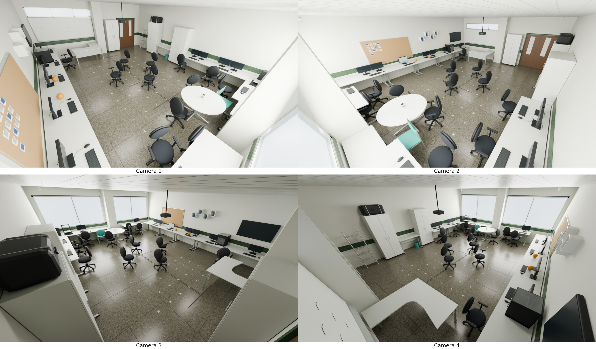

# LabSEA — reconstrução e simulação 3D



## Organização

| Caminho | Conteúdo |
| --- | --- |
| `modelos/labsea_reconstruido.blend` | Modelo atual, com materiais e textura empacotada |
| `modelos/labsea_com_aberturas.blend` | Arquitetura de entrada preservada |
| `modelos/labsea.blend` | Etapa inicial da construção arquitetônica |
| `dados/calibracao/` | Quatro arquivos NPZ originais, sem alterações |
| `scene_data/objects.json` | IDs, poses, dimensões, fontes e confiança dos objetos |
| `scene_data/landmarks.json` | Correspondências manuais usadas na validação geométrica |
| `scene_data/floor_markers.json` | Grade de 77 marcadores preservada do arquivo editado |
| `scene_data/desk_observations.json` | Anotações da foto marcada, correção óptica e raios dos tampos |
| `scripts/blender/` | Construção modular, materiais, câmeras, render e exportação |
| `scripts/cameras/` | Captura IS-Wire, correção, triangulação e comparação |
| `configs/aberturas/` | Configurações da arquitetura original |
| `docs/` | Relatório, inventário e resultados resumidos da validação |
| `saida/` | Capturas, renders, GLB, comparações e diagnósticos locais; fora do Git |

## Ambiente

Foram usados Python 3.14, Blender 5.2.2 e os pacotes de `requirements.txt`:

```bash
python -m venv .venv
source .venv/bin/activate
python -m pip install -r requirements.txt
```

O Blender usa seu próprio Python com `bpy` e `numpy`. Os pacotes externos atendem aos scripts de captura e análise; não instale `bpy` no ambiente virtual.

## Capturar referências

Na rede do laboratório:

```bash
python scripts/cameras/capturar_imagens.py --timeout 20 --max-diferenca 0.5
```

São assinados os tópicos `CameraGateway.1.Frame` a `CameraGateway.4.Frame`. Cada lote em `saida/imagens_reais/` contém `originais/`, `corrigidas_roi/` e `manifesto.json`. O manifesto registra timestamps, resolução e ROI. A correção usa `cv2.undistort(K, dist, nK)` antes do recorte.

O broker pode ser substituído com `LABSEA_BROKER_URI` ou `--broker`. Para processar arquivos já capturados, nomeados `camera_1.png` a `camera_4.png`:

```bash
python scripts/cameras/capturar_imagens.py --originais-dir /caminho/das/imagens
```

Uma nova captura **não reposiciona automaticamente os móveis**. Revise as observações e as poses em `scene_data/objects.json`. As imagens originais servem para materiais; as corrigidas com ROI servem para geometria.

## Construir, renderizar e comparar

Execute na raiz do projeto:

```bash
blender -b modelos/labsea_com_aberturas.blend --python scripts/blender/scene_builder.py
blender -b modelos/labsea_reconstruido.blend --python scripts/blender/renderizar_cameras.py
blender -b modelos/labsea_reconstruido.blend --python scripts/blender/exportar_glb.py
python scripts/cameras/montar_grade.py
python scripts/cameras/comparar_capturas.py --captura saida/imagens_reais/20261014_141328
```

Saídas principais:

- `saida/imagens_sinteticas/camera_1.png` a `camera_4.png`: 1280 × 720, projeção `nK` sem distorção.
- `saida/imagens_sinteticas/grid_cameras.png`: grid 2 × 2.
- `saida/comparacoes/20261014_141328/`: pares real/sintético, diferenças e métricas no mesmo ROI.
- `saida/validacao/`: auditorias de geometria, projeção e movimentação independente.

Para uma prévia rápida:

```bash
blender -b modelos/labsea_reconstruido.blend --python scripts/blender/renderizar_cameras.py -- --cam 3 --preview 50 --samples 12 --saida saida/preview
```

O renderizador preserva a iluminação salva na reconstrução e configura a resolução e o aspecto de pixel específicos de cada câmera. O `.blend` é salvo inicialmente na câmera 1. Para trocar de câmera com a projeção completa, use o script: o aspecto de pixel é uma propriedade da cena no Blender.

A configuração `rendering` em `objects.json` também registra exposições estimadas por câmera. Elas aproximam a luminosidade das referências e não integram a calibração geométrica. As poses e rotações das cadeiras e a grade do piso foram incorporadas aos dados para permitir reconstrução sem perdê-las.

O builder recria os objetos marcados como gerados e atualiza materiais/organização. Uma revisão provisória do pilar das janelas (+5 cm em X), baseada nas informações adicionais do usuário, está explicitamente registrada em `architecture_adjustments`; piso, paredes, janelas e câmeras continuam preservados. Audita as malhas e transformações originais e salva uma cópia diferente da entrada. Reexecuções recriam as mesmas raízes sem duplicação. Poses editadas manualmente nos móveis devem ser transferidas ao JSON antes de reconstruir. As mesas grandes confirmadas têm 1,60 m e as duas menores, 0,80 m; profundidades e revisão do pilar ainda precisam de medição. A impressora sob a TV é a GTMax Core A2V2 (`Printer3D_002`).

## Verificação geométrica

```bash
python scripts/cameras/analisar_referencias.py --planos --mesas
blender -b modelos/labsea_reconstruido.blend --python scripts/blender/validate_scene.py
```

As anotações de cantos da mesa em L usam coordenadas da imagem **corrigida e recortada**. O código repõe o deslocamento do ROI antes de calcular raios. Os diagnósticos de planos usam Z = 0 para piso e Z = 0,75 m para tampos. Objetos fora desses planos aparecem deslocados nesses diagnósticos e não devem ser medidos como se pertencessem a eles.

## Objetos móveis e GLB

Cada cadeira tem uma raiz `Chair_001` a `Chair_013`, com origem no piso, escala unitária e filhos locais. Propriedades: `object_type="chair"`, `dynamic=True`, `trackable=True`, `coordinate_system="world"`.

Exemplo no console do Blender:

```python
import bpy
from math import radians
chair = bpy.data.objects["Chair_001"]
chair.location = (2.4, 3.0, 0.0)
chair.rotation_euler.z = radians(-90)
```

Exporte a cena:

```bash
blender -b modelos/labsea_reconstruido.blend --python scripts/blender/exportar_glb.py
```

O resultado é `saida/labsea.glb`, com hierarquias, nomes e propriedades em `extras`. A textura de granilite acompanha o arquivo; pequenos efeitos procedurais de relevo não são integralmente representados no glTF. As câmeras ópticas não são exportadas: a projeção calibrada permanece no `.blend`/NPZ.

O mundo original usa **Z para cima**. glTF/Three.js usa **Y para cima**. Converta posições por `(x, y, z) → (x, z, -y)`. A rotação em torno de Z do mundo original corresponde à rotação em torno de Y no GLB. Os identificadores de cadeiras representam esta captura; o rastreamento entre capturas ainda precisa associar as identidades.

## Arquitetura e ferramentas anteriores

Os scripts `criar_labsea.py`, `adicionar_aberturas.py` e `adicionar_janela_j16.py` documentam as etapas de geração da arquitetura. Não são necessários para atualizar o mobiliário. `adicionar_modelos_cameras.py` é uma entrada alternativa para adicionar somente carcaças, reutilizando `camera_models.py`.

`visualizar_mapa.py`, `projetar_paredes.py`, `selecionar_pontos.py` e `comparar_cameras.py` continuam disponíveis para inspeção e uso ao vivo. Os resultados anteriores foram mantidos em `saida/historico/` ou nas pastas de diagnóstico, sem substituir as capturas reais.

